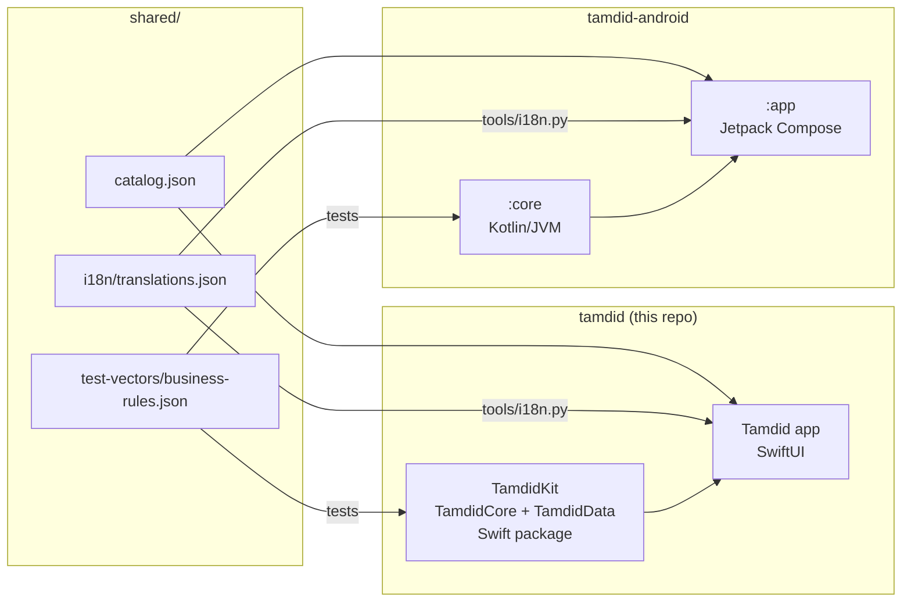

# Architecture

Tamdid is two native apps in two repositories, this one ([tamdid-IOS](https://github.com/Ali-Asadi-Dev/tamdid-IOS)) and [tamdid-android](https://github.com/Ali-Asadi-Dev/tamdid-android). They share **rules, not code**: each platform uses its own idiomatic stack, and the business rules are implemented twice and pinned to the same behaviour by a shared set of test vectors, kept identical in both repositories under `shared/`.

## Layers

| Layer | iOS | Android | Notes |
|---|---|---|---|
| Business rules | `TamdidCore` (Swift package, no UI, no I/O) | `:core` (pure Kotlin/JVM module) | Billing dates, money, Jalali calendar, insights, reminder planning, formatting. Builds and tests on Linux. |
| Persistence | `TamdidData.FileStore` | `FileStore` in `:core` | One JSON document, atomic writes. Same format on both platforms, so a backup made on one restores on the other. |
| State | `AppModel` (`@Observable`, `@MainActor`) | `TamdidRepository` (`StateFlow`) + one ViewModel per screen | Unidirectional: views call intents, the model saves and reschedules reminders. |
| UI | SwiftUI, `NavigationStack`, Swift Charts | Compose, Material 3, type-safe Navigation | Right-to-left handled by the frameworks; formatting comes from the core. |
| Reminders | `UNCalendarNotificationTrigger`, max 60 pending | Inexact `AlarmManager` alarms + boot/time-zone receiver | Both schedule the plan returned by `ReminderPlanner`. |

## Decisions

**Why native twice instead of a cross-platform framework?** The project is a portfolio piece for a senior iOS role, so the iOS app is idiomatic SwiftUI. The Android app exists for the Iranian market (Cafe Bazaar) and is idiomatic Compose. Shared *fixtures* give most of the safety of shared code without either app feeling foreign.

**Why calendar dates (`CivilDate` / `LocalDate`) instead of `Date`?** Renewals happen on days, not instants. Using date-only values removes time-zone and daylight-saving bugs from every rule; conversion to an instant happens only when scheduling a notification.

**Why compute renewals from the anchor?** Repeatedly adding a month drifts: Jan 31 → Feb 28 → Mar 28. Computing the *n*th date from the anchor gives Jan 31 → Feb 28 → Mar 31, which is what billing systems do. A test walks 30 years of month-end renewals to prove it.

**Why minor units (`Int64`/`Long`) for money?** Exact arithmetic. Floating point appears only in *estimates* (monthly equivalent of a weekly plan), which are rounded half-up the same way on both platforms.

**Why format money and dates ourselves?** Platform formatters differ across OS versions and ICU builds, especially for Persian and Arabic. The apps format deterministically and the shared vectors check the exact output (`"۱۲۰٬۰۰۰ تومان"`, `"1.234,56 €"`).

**Why a JSON file instead of Core Data / Room?** A subscription tracker stores tens of records. One document gives atomic all-or-nothing writes, a free backup format, and the same code path on both platforms and in tests. The store sits behind a small interface, so moving to SwiftData/Room later is a contained change.

**Why our own Jalali conversion?** It is a port of the widely used `jalaali-js` algorithm, verified by round-tripping every day across 200 years on both platforms and by fixtures checked against known dates (Nowruz, 22 Bahman 1357).

**Pausing without corrupting history.** Resuming a paused or cancelled subscription moves the payments so far into `pastCharges` (real dates and amounts) and restarts the series on the resume day, so the paused months are never counted as paid and the chart, calendar and totals keep the earlier payments.

## Testing

| Suite | Runs on | What it covers |
|---|---|---|
| `TamdidKit` (Swift Testing) | Linux + macOS CI | Every rule, shared vectors, storage, CSV export |
| `:core` (JUnit) | JVM | The same rules and vectors in Kotlin, plus reading a backup written by iOS |
| `:app` unit tests | JVM | ViewModels: totals, filters, editing with price history, import confirmation |
| `:app` UI tests (Robolectric + Compose) | JVM | Real screens in 5 languages + dark mode, add/delete flows, screenshots |
| `TamdidTests` (Swift Testing) | iOS Simulator | `AppModel` intents, form validation, persistence, reminder rescheduling |
| `TamdidUITests` (XCUITest) | iOS Simulator | Screen tour with screenshots, add-a-subscription flow |
